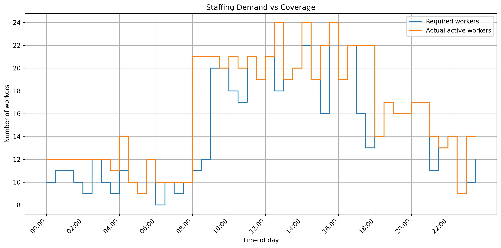
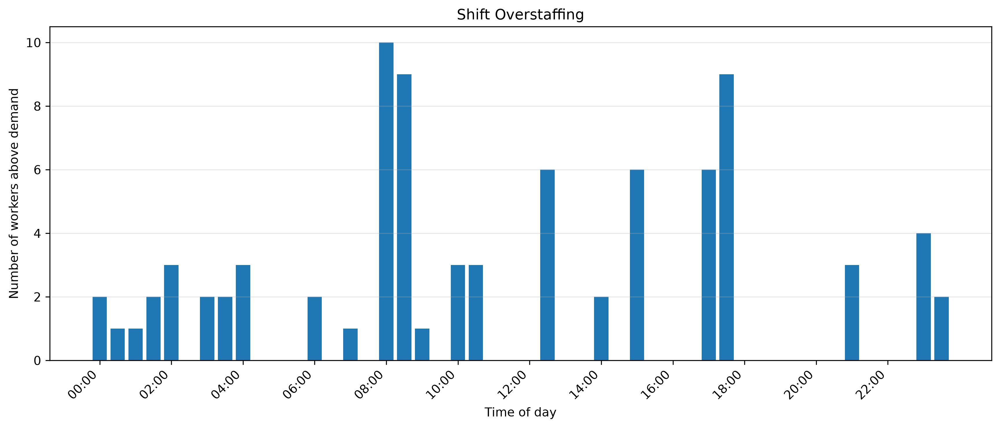

# Warehouse Shift Optimiser

## Overview

The aim of the project is to find a cost-effective combination of employee shifts that meets staffing demand throughout a 24-hour day. The model uses Python and Google OR-Tools CP-SAT to select shift patterns and break times while minimising total labour costs.

The project also evaluates the resulting schedule and visualises staffing coverage and overstaffing to help understand the operational trade-offs.

## Objectives

- Minimise total labour costs.
- Meet staffing demand across the full day.
- Explore different shift start times and durations.
- Schedule unpaid breaks while maintaining sufficient active staffing.
- Evaluate the resulting schedule using quantitative measures.
- Visualise staffing demand, coverage, and overstaffing.

## Technologies Used

- **Python** — model implementation.
- **Google OR-Tools CP-SAT** — constraint programming and optimisation.
- **Pandas** — schedule evaluation and analysis.
- **Matplotlib** — staffing visualisations.

## How It Works

The project follows four main steps:

1. **Generate demand:** Create a synthetic warehouse staffing profile for a 24-hour day, divided into 48 half-hourly time slots.
2. **Optimise shifts:** Use Google OR-Tools CP-SAT to select the number of employees assigned to each shift and break pattern.
3. **Evaluate the schedule:** Use Pandas to calculate staffing coverage, labour costs, and overstaffing.
4. **Visualise results:** Use Matplotlib to compare required staffing with actual active coverage and show where staffing exceeds demand.

## Optimisation Model

The scheduling problem is formulated as a constraint programming model.

### Decision variables

The model determines how many employees should be assigned to each possible combination of shift length and break time.

### Shift options

The current model includes:

- **Shift start times:** 00:00, 04:00, 08:00, 12:00, and 16:00.
- **Shift durations:** 6 or 8 hours.
- **Breaks:** 30min unpaid break per shift.
- **Time intervals:** 48 30min slots covering a full day.
- **Workforce limit:** A maximum of 60 employees.
- **Hourly wage:** £14.

Breaks must begin after at least 2 hours of work and leave at least 1 hour of work before the shift ends.

### Constraints

The model enforces the following requirements:

- Active staffing must meet or exceed demand in every half-hourly time slot (Cannot be understaffed).
- The total number of employees assigned in a day cannot exceed the workforce limit.
- Each selected shift follows one of the permitted shift and break patterns.

### Objective function

The objective is to **minimise total labour costs**.

Assuming breaks are unpaid and all employees receive the same hourly wage:

| Shift duration | Paid hours | Labour cost per employee |
|---|---:|---:|
| 6 hours | 5.5 | £77 |
| 8 hours | 7.5 | £105 |

The solver searches for a feasible schedule with the lowest labour cost. If no feasible solution is found within the solver's search, the model reports that no feasible schedule was found.

## Results and Visualisations

The model produces a selected shift schedule and an evaluation summary. The evaluation includes the number of employees scheduled, total labour cost, staffing coverage, and overstaffing.

### 1. Staffing Demand vs Actual Coverage

This graph compares the required number of workers with the number of active workers scheduled throughout the day.



### 2. Overstaffing by Time Slot

This graph shows how many more workers are scheduled than required in each half-hourly time slot. It helps identify periods where staffing exceeds demand.



## Project Structure

```text
WarehouseShiftOptimiser/
├── generate_data.py       # Generates example staffing demand
├── optimiser.py           # Builds and solves the optimisation model
├── evaluate.py            # Evaluates coverage and labour costs
├── visualise.py           # Creates staffing graphs
├── run_optimisation.py    # Runs the complete workflow
├── images/                # Stored result graphs
└── README.md
```

## Installation and Usage

### 1. Clone the repository

```bash
git clone https://github.com/DCroukamp/WarehouseShiftOptimiser.git
cd WarehouseShiftOptimiser
```

### 2. Install dependencies

```bash
pip install ortools pandas matplotlib
```

### 3. Run the model

```bash
python run_optimisation.py
```

The script generates demand, runs the optimiser, prints the selected schedule and evaluation summary, and displays the visualisations.

## Limitations

The current model is a simplified representation of a warehouse scheduling problem.

- **Synthetic demand:** Staffing requirements are generated rather than taken from real warehouse data.
- **Single-day planning:** The model optimises one 24-hour period and does not coordinate schedules across multiple days.
- **Interchangeable employees:** Individual availability, skills, preferences, and contractual hours are not considered.
- **Fixed shift options:** Only predefined start times and 6- or 8-hour shifts are available.
- **Simplified break rules:** Each shift has one 30-minute break. More detailed employment regulations and break policies are not modelled.
- **Simplified labour costs:** The model uses a fixed hourly wage and does not account for overtime, night premiums, or other employment costs.
- **Deterministic demand:** Demand is assumed to be known in advance and does not change unexpectedly.
- **Simplified objective:** The model minimises labour costs but does not directly penalise overstaffing or account for other operational performance measures.

## Potential Future Improvements

- Use historical warehouse demand data.
- Extend the model to multiple days, including employee rest periods.
- Incorporate employee-specific availability and skills.
- Add more flexible shift patterns and break policies.
- Include overtime and shift premiums in the cost function.
- Compare the optimised schedule against a baseline to quantify potential savings.
